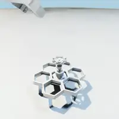
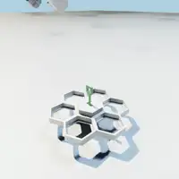
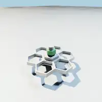

# HiveBoard RL

[](https://github.com/isaac-sim/IsaacLab/commit/78b12aed1d2a56439493b8ea6d3538e6e379e2e5)
[](https://www.python.org/)
[](https://github.com/leggedrobotics/rsl_rl)

<table>
  <tr>
    <td align="center"><br>Ball valve</td>
    <td align="center"><br>Small valve (2x)</td>
    <td align="center"><br>Circuit breaker</td>
    <td align="center"><br>Key</td>
  </tr>
  <tr>
    <td align="center"><br>M30 thread (8x)</td>
    <td align="center"><br>M8 thread (8x)</td>
    <td align="center"><br>Shock pin</td>
    <td align="center"><br>Button</td>
  </tr>
</table>


Policy learning and sim-to-real for the
**[HiveBoard Benchmark](https://hiveboard-bench.github.io/)**. Environments, robots and scripted
experts come from [isaaclab-hiveboard](https://github.com/hiveboard-bench/isaaclab-hiveboard),
simulated with Newton MJWarp (no Isaac Sim needed). This repository adds learning only.

## Installation

```bash
git clone https://github.com/hiveboard-bench/hiveboard-rl.git
cd hiveboard-rl
just setup
just assets
```

## Quickstart

```bash
just bank                          # roll out and filter the cuRobo expert
just train                         # PPO from expert-bank starts
just eval path/to/model.pt         # success and progress metrics
just video path/to/model.pt videos # publication videos, nominal physics and no noise
just bc path/to/demos.pt           # behavior cloning warm start
just all                           # every robot and task, gated on expert success
```

Select a robot and task with `RL_ROBOT=anymal RL_TASK=open_ball_valve_simple`. Every robot with
a `configs/robots/<robot>.yaml` is registered with every core task.

## Method

We are actively training and deploying the **HiveBoard baselines**, the reference policies for the benchmark. Those policies are scripted from expert heuristics to serve as control demonstrations for task-sovling and sim-to-real. The pipeline is:

**cuRobo scripted expert -> expert bank -> PPO (optional BC warm start) -> eval and video**

- **Expert bank.** The core expert is rolled out in parallel and filtered on success. Training
  episodes start from bank states, mid-trajectory for half of the resets.
- **PPO.** Blind (no vision) asymmetric actor-critic on
  [RSL-RL](https://github.com/leggedrobotics/rsl_rl). The actor sees proprioception and noisy
  target estimates; the critic also sees privileged state.
- **Sim-to-real.** Mechanism dynamics randomization, actuation and target delays, observation
  noise and gripper thresholds. Robot-specific knobs live in the per-robot YAML.


> By default, `just all` trains only pairs whose expert success reaches 0.8.

Tabula-rasa RL, vision-based policies and more are planned or in development.

## Current Support

| Robot | Learning config | Expert status |
|---|---|---|
| ANYmal-D + DynaArm + Robotiq 2F-140 | `configs/robots/anymal.yaml` | Supported |
| Franka Research 3 + Franka Hand | `configs/robots/franka.yaml` | Partially supported |
| Spot + Arm | not registered | In development |

Environments and support expansion can also be verified at
[isaaclab-hiveboard](https://github.com/hiveboard-bench/isaaclab-hiveboard#current-support).


## Adding a task

1. Generate its Newton USD with `just assets`.
2. Add an `AssetCfg` and a `TaskCfg` in core `isaaclab_hiveboard/tasks_simple.py`.
3. `just bank` checks expert success. Train only above the gate.

It is expected that a new kind of motion adds one method to the core `expert()`.Then, assets with that motion ought to reuse it.
