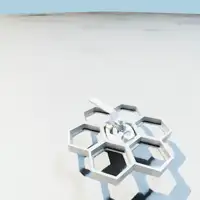
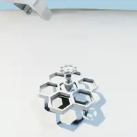
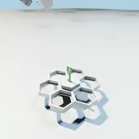
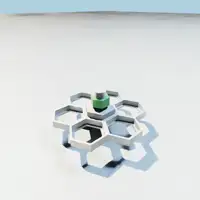
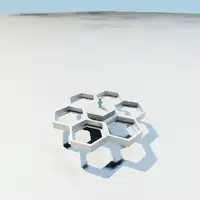
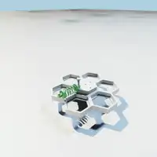
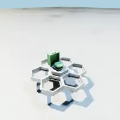

# HiveBoard RL

[](https://github.com/isaac-sim/IsaacLab/commit/78b12aed1d2a56439493b8ea6d3538e6e379e2e5)
[](https://www.python.org/)
[](https://github.com/leggedrobotics/rsl_rl)

<table>
  <tr>
    <td align="center"><br>Ball valve</td>
    <td align="center"><br>Small valve (2x)</td>
    <td align="center"><br>Circuit breaker</td>
    <td align="center"><br>Key</td>
  </tr>
  <tr>
    <td align="center"><br>M30 thread (8x)</td>
    <td align="center"><br>M8 thread (8x)</td>
    <td align="center"><br>Shock pin</td>
    <td align="center"><br>Button</td>
  </tr>
</table>


Policy learning and sim-to-real for the
**[HiveBoard Benchmark](https://hiveboard-bench.github.io/)**. Environments, robots and scripted
experts come from [isaaclab-hiveboard](https://github.com/hiveboard-bench/isaaclab-hiveboard),
simulated with Newton MJWarp (no Isaac Sim needed). This repository adds learning only.

## Installation

`just` uses local `.venv` environments, including when Conda is active. uv selects Python 3.12
for this project and keeps the USD converter in its own environment.

```bash
git clone https://github.com/hiveboard-bench/hiveboard-rl.git
cd hiveboard-rl
just setup
just assets
```

## Quickstart

```bash
just bank                          # roll out and filter the cuRobo expert
just train                         # PPO from expert-bank starts
just eval path/to/model.pt         # success and progress metrics
just video path/to/model.pt videos # publication videos, nominal physics and no noise
just bc path/to/demos.pt           # behavior cloning warm start
just all                           # every robot and task, gated on expert success
```

Select a robot and task with `RL_ROBOT=anymal RL_TASK=open_ball_valve_simple`. Every robot with
a `configs/robots/<robot>.yaml` is registered with every core task.

If bank collection runs out of GPU memory, use `just bank --plan_batch_size 64` to limit
cuRobo planning batches independently of `--num_envs`. Changing the planner batch can change
the collected trajectories for a given seed; keep it fixed when comparing runs.

## Method

We are actively training and deploying the **HiveBoard baselines**, the reference policies for the benchmark. Those policies are scripted from expert heuristics to serve as control demonstrations for task-sovling and sim-to-real. The pipeline is:

**cuRobo scripted expert -> expert bank -> PPO (optional BC warm start) -> eval and video**

- **Expert bank.** The core expert is rolled out in parallel and filtered on success. Training
  episodes start from bank states, mid-trajectory for half of the resets.
- **PPO.** Blind (no vision) asymmetric actor-critic on
  [RSL-RL](https://github.com/leggedrobotics/rsl_rl). The actor sees proprioception and noisy
  target estimates; the critic also sees privileged state.
- **Sim-to-real.** Mechanism dynamics randomization, actuation and target delays, observation
  noise and gripper thresholds. Robot-specific knobs live in the per-robot YAML.


> By default, `just all` trains only pairs whose expert success reaches 0.8.

Tabula-rasa RL, vision-based policies and more are planned or in development.

## Current Support

| Robot | Learning config | Expert status |
|---|---|---|
| ANYmal-D + DynaArm + Robotiq 2F-140 | `configs/robots/anymal.yaml` | Supported |
| Franka Research 3 + Franka Hand | `configs/robots/franka.yaml` | Partially supported |
| Spot + Arm | not registered | In development |

Environments and support expansion can also be verified at
[isaaclab-hiveboard](https://github.com/hiveboard-bench/isaaclab-hiveboard#current-support).


## Adding a task

1. For a new mechanism, generate its Newton USD with `just assets` and add its `AssetCfg` and
   `TaskCfg` in core `isaaclab_hiveboard/tasks_simple.py`. Existing core tasks are registered already.
2. Put learning overrides under `tasks.<task_name>` in `configs/train.yaml` or the robot YAML.
   Each entry supports `env`, `agent`, `play`, `expert` and `publication`. Shared and robot defaults
   are applied first, then shared task and robot task settings, then execution-mode settings.
3. Collect a task-specific bank and replay it with `just eval <bank.pt> --policy expert` before
   training. Use a separate collection seed for the held-out bank.

It is expected that a new kind of motion adds one method to the core `expert()`.Then, assets with that motion ought to reuse it.

## Franka circuit breaker

See the [task documentation](docs/franka/switch_circuit_breaker_simple/README.md) for the video,
reward details and evaluation results.

`switch_circuit_breaker_simple` pushes the toggle from +30 to -30 degrees with closed fingers,
then withdraws. It trains a separate policy with the same PPO architecture as the valve.
Push progress requires pad contact during the episode, including contact before a bank mid-start.
Progress and completion pay once, and can continue after contact ends. Mechanism reference positions
come from the bank; the expert speed command is in m/s. Pinch and fixed-target reach rewards are
disabled. Force costs penalize total pad force above 150 N and force perpendicular to the push axis
above 35 N. The push axis follows mechanism-local Z (world X at the nominal Franka pose).
Mechanism-lag termination is disabled to allow timing differences in the toggle transition.

```bash
export RL_ROBOT=franka RL_TASK=switch_circuit_breaker_simple
heldout=logs/expert_bank/franka_switch_circuit_breaker_simple_heldout.pt
just bank --num_trajectories 1000 --plan_batch_size 64
just bank --num_trajectories 200 --plan_batch_size 64 --seed 10020 \
    --output "$heldout"
just train --num_envs 4096 --seed 0 --max_iterations 1000 \
    env.sim.physics.use_cuda_graph=true env.sim.physics.solver_cfg.iterations=50 \
    env.sim.physics.solver_cfg.ls_iterations=10 env.sim.physics.solver_cfg.ccd_iterations=30
just eval <checkpoint.pt> --episodes 300 --num_envs 100 --seed 100 \
    env.events.reset_from_bank.params.path="$heldout" \
    env.sim.physics.use_cuda_graph=true env.sim.physics.solver_cfg.iterations=50 \
    env.sim.physics.solver_cfg.ls_iterations=10 env.sim.physics.solver_cfg.ccd_iterations=30
```

Select checkpoints by held-out complete rate: a credited switch followed by withdrawal, with the
toggle still at its goal. The training uploader's best-return checkpoint is a different metric.

## Franka small valve

See the [task documentation](docs/franka/open_small_valve_simple/README.md) for the policy video,
reward details, evaluation results and `just` commands.

`open_small_valve_simple` pinches the wheel, turns it open, releases and withdraws.
PPO fine-tunes a grasping checkpoint with binary gripper-command matching, bilateral pinch
rewards and penalties for ungripped turning, excessive pad forces and net pulling, pushing
and sideways loads. The documented checkpoint completed 296/300 held-out episodes (98.7%),
with a bilateral pinch in all 300. Force thresholds are soft; rare high-force impacts remain.
