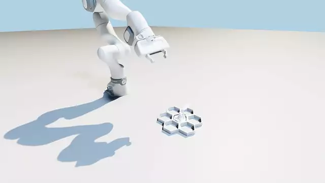

# Franka FR3 open ball valve (simple)



This method on a held-out start (2x speed). It pinches the lever, opens the valve, releases and backs off.

## Task

The task lives in `tasks_simple.py` of `isaaclab-hiveboard` and the RL layer in `env.py`, `configs/train.yaml` and `configs/robots/franka.yaml`.

| | |
|---|---|
| Robot | Franka Research 3 with Franka Hand |
| Goal | turn the lever a quarter turn to open the valve |
| Randomization | valve orientation, mechanism dynamics, delays and observation noise |
| Starts | states from the cuRobo expert bank |
| Gym ID | `Isaac-HiveBoard-Franka-OpenBallValveSimple-RL-v0` |

## Method

Master follows the expert arm but not its gripper, so the policy learns to push the lever open with open fingers. The rewards are split into a task signal that only pays while the lever is pinched, a style signal that copies the expert bank, and hardware terms for smooth and safe motion.

| Group | Term | Weight | What it does |
|---|---|---|---|
| Task | `task_progress` (new) | 10 | valve progress, counted only while pinched |
| Task | `pinch_lever` (new) | 5 | both pads squeeze the lever while the expert grips |
| Task | `reach_lever` (new) | 3 | gripper close to the lever while the expert grips |
| Style | `track_expert_mechanism` (gated) | 6 | valve angle follows the expert, off when the expert grips but the policy does not |
| Style | `track_expert_mechanism_coarse` (gated) | 5 | same with a wider tolerance |
| Style | `track_expert` | 3 | arm joints follow the expert |
| Style | `track_expert_gripper` (wider) | 3 | fingers follow the expert |
| Style | `track_expert_contact` | 3 | pad contact matches the expert |
| Style | `track_expert_coarse` | 2 | arm joints follow the expert, wider tolerance |
| Style | `track_expert_velocity` (enabled) | 2 | arm joint velocity follows the expert |
| Hardware | `pad_lateral` (new) | -5 | high sideways pad force |
| Hardware | `torque_saturation` (new) | -2 | joint torque near the limit |
| Hardware | `action_rate` (stronger) | -1 | jerky actions |
| Hardware | `gripper_chatter` (new) | -1 | gripper toggling quickly |
| Hardware | `joint_limits` (new) | -1 | joints near their limits |
| Hardware | `overspeed` | -1 | valve turned too fast |
| Hardware | `arm_joint_acc` (new) | -0.03 | high joint acceleration |
| Hardware | `action_magnitude` | -0.02 | large actions |
| Hardware | `arm_joint_vel` | -0.001 | fast arm joints |

Episodes also end when the arm hits something, and the critic sees the pinch state and the credited progress.

## Results

Baseline is master at `52f25f0` with the NaN fix from the first commit of this branch. Both were trained the same way for 500 iterations and evaluated on 300 episodes from a held-out expert bank.

| Complete rate | 200 it | 300 it | 400 it | 499 it |
|---|---|---|---|---|
| `52f25f0` | 0% | 2% | 0% | 1% |
| This method | 35% | 89% | 77% | **89%** |

| At 499 it | `52f25f0` | This method |
|---|---|---|
| Pinched the lever | 0% | 94% |
| Lateral pad force p99 | 386 N | 89 N |
| Arm collisions | 117 / 300 | 0 / 300 |

Five more episodes on random held-out starts all completed with a pinch.

## What needs to be improved

- **Value loss is high** and grows during training. The drift terminations cut long returns short, so return normalization or a softer drift limit should help.
- **Generalization** should improve with more varied start states and expert behaviours in the bank, since the expert succeeds only about a third of the time.
- **The gripper sometimes does not release** after opening the valve, which explains the dip at 400 iterations. Pick checkpoints by held-out eval for now.

## Reproduce

```bash
export RL_ROBOT=franka RL_TASK=open_ball_valve_simple
just bank --num_trajectories 1000
just bank --num_trajectories 200 --seed 10020 --output <heldout_bank.pt>
just train --num_envs 4096 --seed 0 --max_iterations 500 \
    env.sim.physics.use_cuda_graph=true env.sim.physics.solver_cfg.iterations=50 \
    env.sim.physics.solver_cfg.ls_iterations=10 env.sim.physics.solver_cfg.ccd_iterations=30
just eval logs/rsl_rl/franka_open_ball_valve_simple/<run>/model_499.pt --episodes 300 \
    --num_envs 100 --seed 100 env.events.reset_from_bank.params.path=<heldout_bank.pt> \
    env.sim.physics.use_cuda_graph=true
```
