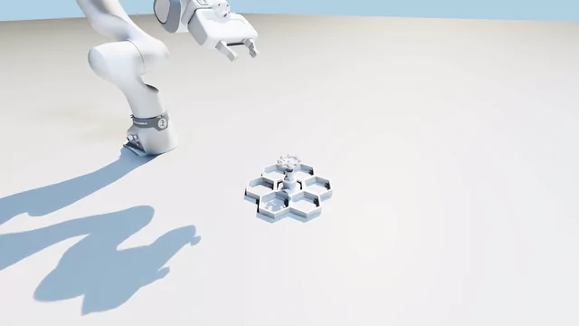

# Franka FR3 open small valve (simple)



`model_999.pt` pinches the wheel, opens the valve, releases and withdraws
(2x speed, nominal physics).

## Task

The task lives in core `tasks_simple.py`. Learning shares `env.py`,
`configs/train.yaml` and `configs/robots/franka.yaml` with the
[ball-valve](../open_ball_valve_simple/README.md) and
[circuit-breaker](../switch_circuit_breaker_simple/README.md) policies.

| | |
|---|---|
| Robot | Franka Research 3 with Franka Hand |
| Goal | turn the wheel to -90 degrees, then release and withdraw |
| Goal tolerance | 0.035 rad, approximately 2 degrees |
| Interaction | bilateral pinch during turning; open fingers for release |
| Episode | 17 seconds at a 20 Hz policy rate |
| Starts | states from a task-specific cuRobo expert bank |
| Randomization | mechanism position and dynamics, arm starts, delays and observation noise |
| Gym ID | `Isaac-HiveBoard-Franka-OpenSmallValveSimple-RL-v0` |

## Method

PPO fine-tunes a grasping policy with `[512, 256, 128]` actor and critic MLPs.
The actor sees proprioception, an initial mechanism estimate and five-frame history;
the critic also sees true state, contacts, dynamics and expert errors.

The expert approaches, grips, turns, releases and retreats, with regrasp cycles when needed.
The training bank has 1,000 trajectories (99.0% raw expert success); the held-out bank has
200 (99.4%, seed 10020). Collection uses 512 environments and planning batches of 64,
keeping successful trajectories with no planner fallback and a clear withdrawal.

Half of training resets start mid-trajectory. Wheel references follow recorded bank angles,
including pauses for release and regrasp. Task overrides live under
`tasks.open_small_valve_simple` in the Franka YAML.

## Rewards

| Group | Term | Weight | What it does |
|---|---|---|---|
| Task | `task_progress` | 10 | new opening progress while pinched, plus completion |
| Task | `pinch_lever` | 10 | bilateral pinch while the expert grips |
| Task | `reach_lever` | 3 | grasp alignment: 3 cm position and 0.35 rad orientation scales |
| Task | `release_clear` | 3 | credited goal, open fingers and clear withdrawal |
| Style | `track_gripper_command` | 10 | match the expert's binary open/close command |
| Style | `track_expert_gripper` | 2 | measured finger position, 5 mm reward width |
| Style | `track_expert_mechanism` | 6 | expert valve angle, 0.1 rad width, grip-gated |
| Style | `track_expert_mechanism_coarse` | 5 | same with a 0.5 rad width |
| Style | `track_expert` | 3 | expert arm joint positions, 0.15 rad width |
| Style | `track_expert_coarse` | 2 | same with a 0.5 rad width |
| Style | `track_expert_velocity` | 2 | expert arm joint velocities, 0.15 rad/s width |
| Style | `track_expert_contact` | 3 | each pad's contact state matches the expert |
| Hardware | `turn_without_pinch` | -10 | ungripped mechanism speed above 0.03 rad/s |
| Hardware | `pad_force` | -0.005 | squared total pad-force excess above 100 N |
| Hardware | `pad_lateral` | -5 | gripper-relative lateral pad force above 25 N |
| Hardware | `mechanism_pull` | -0.01 | squared net outward-force excess above 10 N |
| Hardware | `mechanism_push` | -0.005 | squared net inward-force excess above 15 N |
| Hardware | `mechanism_lateral` | -0.005 | squared net sideways-force excess above 20 N |
| Hardware | `overspeed` | -1 | mechanism speed above 1.5x the commanded rate |
| Hardware | `torque_saturation` | -2 | joint torque above 80% of its limit |
| Hardware | `action_rate` | -1 | changes in commanded actions |
| Hardware | `joint_limits` | -1 | arm joints within 0.1 rad of a limit |
| Hardware | `gripper_chatter` | -1 | gripper switches less than 0.5 s apart |
| Hardware | `arm_joint_acc` | -0.03 | control-rate joint acceleration, quadratic to 10 rad/s2 |
| Hardware | `action_magnitude` | -0.02 | large actions |
| Hardware | `arm_joint_vel` | -0.001 | fast arm joints |

A pinch requires a close command, at least 5 N of squeeze on both pads and finger joint
positions above 10.6 mm. The pinch reward is binary. Progress pays only for new credited
gains; completion adds a one-time 0.5 bonus before weighting. Release requires credited
completion, pad forces below 1 N and TCP clearance of at least 6 cm.

Binary command matching rewards the grip and release phases directly. Mechanism tracking
requires a policy pinch whenever the expert has both pads in contact. `pad_lateral` is
quadratic from 25 to 100 N, then linear; total pad-force costs sum over both pads.

Net loads are forces on the valve from both pads, expressed in its wheel frame:
+Z pulls outward/up, -Z pushes inward/down, and XY gives sideways load.
Opposing squeeze forces cancel in these net loads. All force thresholds are soft penalties.

## Evaluation and results

Force-aware fine-tuning uses seed 0, 4,096 environments and a 1,000-iteration stage,
initialized from a grasping checkpoint. The completed run is
`2026-11-13_13-19-29_grasp_force_resume/model_999.pt`.

Evaluation used 300 episodes, 100 environments and seed 100, visiting 148 distinct held-out
bank entries. Solver settings match training (50/10/30). Starts use bank dynamics,
registration noise and target delay; expert drift terminations are disabled.

**Success** requires the goal while held by the closed-gripper pose check; bilateral pinch
is reported separately. **Complete** also retains the goal and finishes released and clear.

| Metric | Result |
|---|---|
| Success and complete | **296/300 (98.7%)** |
| Episodes with a bilateral pinch | **300/300 (100%)** |
| Time to goal, mean +/- std | **7.21 +/- 0.73 s** |
| Peak pad force, median / p99 | 107 / 153 N |
| Maximum pad force | 691 N |
| Peak gripper-relative lateral force, median / p99 | 74 / 141 N |
| Peak net pull, median / p99 | 26 / 99 N |
| Peak net push, median / p99 | 32 / 111 N |
| Peak net sideways load, median / p99 | 51 / 105 N |
| Collisions / invalid episodes | 0 / 0 |

Force quantiles use each episode's peak. Mean pinch duration was 5.19 s;
20 episodes had a gripper switch within 0.5 s of the previous switch.
The full report is `eval_model_999.json` alongside the checkpoint.

## What needs to be improved

- **Force spikes:** the soft penalties still allow rare impacts, including the 691 N peak.
- **Gripper timing:** four incomplete episodes and 20 quick-toggle cases remain.
- **Validation:** repeat training seeds and collect fresh starts after checkpoint selection.

## Reproduce

Run from the repository root after `just setup` and `just assets`.

```bash
export RL_ROBOT=franka RL_TASK=open_small_valve_simple
root=logs/rsl_rl/franka_open_small_valve_simple
heldout=logs/expert_bank/franka_open_small_valve_simple_heldout.pt

just bank --num_trajectories 1000 --plan_batch_size 64 --seed 0
just bank --num_trajectories 200 --plan_batch_size 64 --seed 10020 \
    --output "$heldout"
```

Fine-tuning requires the grasping checkpoint from
[W&B](https://wandb.ai/joao-h02-usp-universidade-de-s-o-paulo/isaaclab-hiveboard/runs/95eef4cv).
With that checkpoint available at `base`, prepare a new stage at iteration zero,
preserving the actor, critic, normalizers and optimizer:

```bash
base="$root/2026-11-11_13-00-47_grasp_release/model_999.pt"
init="$root/grasp_force_init.pt"
uv run python - "$base" "$init" <<'PY'
import sys
import torch

state = torch.load(sys.argv[1], map_location="cpu", weights_only=False)
state["iter"] = 0
torch.save(state, sys.argv[2])
PY

just train --checkpoint "$init" --num_envs 4096 --seed 0 --max_iterations 1000 \
    --run_name grasp_force_refine \
    env.sim.physics.use_cuda_graph=true env.sim.physics.solver_cfg.iterations=50 \
    env.sim.physics.solver_cfg.ls_iterations=10 env.sim.physics.solver_cfg.ccd_iterations=30
```

Keep collection batch sizes fixed for comparisons. Use the completed checkpoint below,
or replace `run` with the directory produced by your training run.

```bash
run="$root/2026-11-13_13-19-29_grasp_force_resume"
checkpoint="$run/model_999.pt"

just eval "$checkpoint" --episodes 300 --num_envs 100 --seed 100 \
    env.events.reset_from_bank.params.path="$heldout" \
    env.sim.physics.use_cuda_graph=true env.sim.physics.solver_cfg.iterations=50 \
    env.sim.physics.solver_cfg.ls_iterations=10 env.sim.physics.solver_cfg.ccd_iterations=30
```

## Visualize and record

Default camera: eye `[0.90, -0.55, 0.50]`, lookat `[0.60, 0.00, 0.10]`, relative to environment 0.
Viewer results use a separate output file to preserve the 300-episode report.

```bash
mkdir -p tests
just eval "$checkpoint" --episodes 100 --num_envs 1 --visualizer newton_gl --seed 100 \
    --output tests/small_valve_grasp_force_viewer.json \
    env.events.reset_from_bank.params.path="$heldout" \
    env.sim.physics.use_cuda_graph=true env.sim.physics.solver_cfg.iterations=50 \
    env.sim.physics.solver_cfg.ls_iterations=10 env.sim.physics.solver_cfg.ccd_iterations=30
```

Publication recording uses 1080p RTX rendering and CRF 12 encoding: one standard-start episode
with nominal physics and no observation noise or delays, separate from held-out evaluation.

```bash
video=videos/franka_open_small_valve_simple_grasp_force
just video "$checkpoint" "$video" --seed 100 \
    env.sim.physics.use_cuda_graph=true env.sim.physics.solver_cfg.iterations=50 \
    env.sim.physics.solver_cfg.ls_iterations=10 env.sim.physics.solver_cfg.ccd_iterations=30
```
