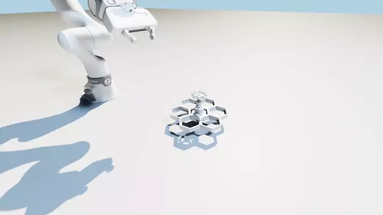

# Franka FR3 open small valve (simple)



This method on a held-out start (2x speed). It pinches the wheel, opens the valve, releases and backs off.

## Task

The task lives in `tasks_simple.py` of `isaaclab-hiveboard` and the RL layer in `env.py`, `configs/train.yaml` and `configs/robots/franka.yaml`.

| | |
|---|---|
| Robot | Franka Research 3 with Franka Hand |
| Goal | turn the wheel to -90 degrees, then release and withdraw |
| Randomization | mechanism position and dynamics, delays and observation noise |
| Starts | states from the cuRobo expert bank |
| Gym ID | `Isaac-HiveBoard-Franka-OpenSmallValveSimple-RL-v0` |

## Method

PPO is trained from scratch on top of the [ball valve](../open_ball_valve_simple/README.md) rewards. The wheel reference follows the bank angles. Changes are marked against the previous small valve version, which also had grip-command, turn-without-pinch, valve-load and release terms.

| Group | Term | Weight | What it does |
|---|---|---|---|
| Task | `task_progress` | 10 | valve progress, counted only while pinched |
| Task | `pinch_lever` | 10 | both pads squeeze the wheel while the expert grips |
| Task | `reach_lever` | 3 | gripper position and orientation at the grasp while the expert grips |
| Style | `track_expert_mechanism` | 6 | valve angle follows the expert, gated on the pinch |
| Style | `track_expert_mechanism_coarse` | 5 | same with a wider tolerance |
| Style | `track_expert` | 3 | arm joints follow the expert |
| Style | `track_expert_contact` | 3 | pad contact matches the expert |
| Style | `track_expert_gripper` | 2 | fingers follow the expert within 5 mm |
| Style | `track_expert_coarse` | 2 | arm joints follow the expert, wider tolerance |
| Style | `track_expert_velocity` (tighter) | 2 | arm joint velocity follows the expert within 0.05 rad/s |
| Hardware | `pad_lateral` | -5 | sideways pad force from 25 to 100 N |
| Hardware | `torque_saturation` | -2 | joint torque near the limit |
| Hardware | `action_rate` | -1 | jerky actions |
| Hardware | `gripper_chatter` | -1 | gripper toggling quickly |
| Hardware | `joint_limits` | -1 | joints near their limits |
| Hardware | `overspeed` | -1 | valve turned too fast |
| Hardware | `arm_joint_acc` | -0.03 | high joint acceleration |
| Hardware | `action_magnitude` | -0.02 | large actions |
| Hardware | `pad_force` | -0.005 | pad force above 100 N |
| Hardware | `arm_joint_vel` | -0.001 | fast arm joints |

## Results

The baseline is the previous version at `3266132`. Both were trained from scratch the same way for 1,000 iterations and evaluated on 300 episodes from a held-out expert bank.

| Complete rate | 600 it | 800 it | 999 it |
|---|---|---|---|
| `3266132` | 33% | 88% | 91% |
| This method | 62% | 80% | **93%** |

| At 999 it | `3266132` | This method |
|---|---|---|
| Pinched the wheel | 98% | 100% |
| Arm acceleration before closing | 1.22 rad/s2 | 0.74 rad/s2 |
| Arm speed at close | 0.21 rad/s | 0.18 rad/s |
| TCP error at close | 10.7 mm | 9.9 mm |
| Quick gripper toggles per episode | 0.78 | 0.26 |
| Lateral pad force p99 | 187 N | 229 N |
| Net pull median / p99 | 39 / 136 N | 93 / 183 N |
| Maximum pad force | 398 N | 1,242 N |
| Arm collisions | 0 / 300 | 0 / 300 |

Reach metrics are taken at the gripper close that leads to the pinch, over 100 held-out episodes.

## What needs to be improved

- **The gripper closes in free air** at the start of 65% of episodes and opens again before the wheel.
- **Valve loads are higher**: net pull doubled and one episode hit a 1,242 N sideways pad force.
- **The wheel still moves before a firm pinch** in about 90% of episodes.

## Reproduce

```bash
export RL_ROBOT=franka RL_TASK=open_small_valve_simple
just bank --num_trajectories 1000 --plan_batch_size 64
just bank --num_trajectories 200 --plan_batch_size 64 --seed 10020 --output <heldout_bank.pt>
just train --num_envs 4096 --seed 0 --max_iterations 1000 \
    env.sim.physics.use_cuda_graph=true env.sim.physics.solver_cfg.iterations=50 \
    env.sim.physics.solver_cfg.ls_iterations=10 env.sim.physics.solver_cfg.ccd_iterations=30
just eval logs/rsl_rl/franka_open_small_valve_simple/<run>/model_999.pt --episodes 300 \
    --num_envs 100 --seed 100 env.events.reset_from_bank.params.path=<heldout_bank.pt> \
    env.sim.physics.use_cuda_graph=true env.sim.physics.solver_cfg.iterations=50 \
    env.sim.physics.solver_cfg.ls_iterations=10 env.sim.physics.solver_cfg.ccd_iterations=30
```
