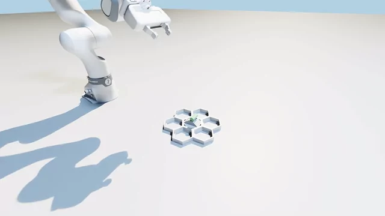

# Franka FR3 switch circuit breaker (simple)



`model_999.pt` switches the toggle and withdraws with closed fingers (2x speed, nominal physics).

## Task

The task lives in core `tasks_simple.py`. Learning shares `env.py`, `configs/train.yaml` and
`configs/robots/franka.yaml` with the
[ball-valve policy](../open_ball_valve_simple/README.md).

| | |
|---|---|
| Robot | Franka Research 3 with Franka Hand |
| Goal | push the toggle from +30 to -30 degrees, then withdraw |
| Goal tolerance | 0.1 rad, approximately 5.7 degrees |
| Interaction | either finger pad can push; no pinch or finger opening is required |
| Episode | 9 seconds at a 20 Hz policy rate |
| Starts | states from a task-specific cuRobo expert bank |
| Randomization | mechanism position and dynamics, arm starts, target delay and observation noise |
| Gym ID | `Isaac-HiveBoard-Franka-SwitchCircuitBreakerSimple-RL-v0` |

## Method

A separate PPO policy is trained from scratch with `[512, 256, 128]` actor and critic MLPs.
The actor sees proprioception, an initial mechanism estimate and history; the critic also sees
true state, contacts, dynamics and expert errors.

The expert approaches below the toggle, pushes along its switching axis with closed fingers and
retreats. The training bank has 1,000 trajectories (96.8% raw expert success); the held-out bank has 200
(98.6%, seed 10020). Collection used 512 environments and planning batches of 64, filtering out
fallbacks, incomplete withdrawals and switches taking over five seconds.

Half of training resets start mid-trajectory, restoring state, dynamics and prior contact history.
Push-specific rewards replace the valve's pinch and reach incentives. Overrides live under
`tasks.<task_name>` in the shared or robot YAML; the valve configuration remains unchanged.

## Rewards

| Group | Term | Weight | What it does |
|---|---|---|---|
| Task | `task_progress` | 10 | credits new progress after valid pad contact, plus completion |
| Style | `track_expert_mechanism` | 6 | tracks the expert angle, with a contact gate |
| Style | `track_expert_mechanism_coarse` | 5 | same with a wider tolerance |
| Style | `track_expert` | 3 | arm joints follow the expert |
| Style | `track_expert_gripper` | 3 | fingers follow the expert's measured position |
| Style | `track_expert_contact` | 3 | each pad's contact state matches the expert |
| Style | `track_expert_coarse` | 2 | arm joints follow the expert, wider tolerance |
| Style | `track_expert_velocity` | 2 | arm joint velocity follows the expert |
| Hardware | `torque_saturation` | -2 | joint torque near its limit |
| Hardware | `action_rate` | -1 | changes in commanded actions |
| Hardware | `joint_limits` | -1 | joints near their limits |
| Hardware | `gripper_chatter` | -1 | gripper commands toggling quickly |
| Hardware | `arm_joint_acc` | -0.03 | high arm joint acceleration |
| Hardware | `action_magnitude` | -0.02 | large actions |
| Hardware | `arm_joint_vel` | -0.001 | fast arm joints |
| Hardware | `pad_force` | -0.002 | squared pad force above 150 N |
| Hardware | `pad_lateral` | -2 | force perpendicular to the push axis, above 35 N |

Progress pays only for new gains after either pad exceeds 1 N, including motion after contact ends.
Completion adds a one-time 0.5 bonus before weighting. The critic sees progress and contact history.
Mechanism tracking uses bank angles with 0.1/0.5 rad tolerances and requires current policy contact
whenever the expert touches. Push speed is measured in m/s.

The push follows mechanism-local +Z (world -X at the nominal Franka pose). `pad_lateral` uses
`axis: 2` to penalize each pad's force perpendicular to that axis, following mechanism orientation.
Its normalized cost is quadratic from 35 to 150 N, then linear. `pad_force` penalizes squared
excess above 150 N per pad in every direction. Both costs sum over the two pads.
Evaluation reports off-axis forces separately from gripper-relative lateral forces.

`pinch_lever`, `reach_lever` and `overspeed` are off. Mechanism-lag termination is disabled;
arm drift, invalid-state and collision terminations remain.

## Evaluation and results

Run `2026-11-06_13-55-44_force_penalties`: seed 0, 4,096 environments, 1,000 PPO iterations.
Evaluation of `model_999.pt` used 300 episodes, 100 environments and seed 100,
visiting 143 distinct held-out bank entries.
Solver settings matched training (50/10/30). Evaluation starts at the beginning of trajectories,
with bank dynamics, registration noise and target delay. Expert drift terminations are disabled.

**Success** requires reaching the goal after pad contact. **Complete** requires the goal retained
at the end, pad forces below 1 N and TCP clearance of at least 6 cm from `lever_pivot_below`.

| Metric | Result |
|---|---|
| Success and complete | **300/300 (100%)** |
| Time to switch, mean +/- std | **3.25 +/- 0.05 s** |
| Maximum pad force | 403 N |
| Peak pad force, median / p99 | 148 / 343 N |
| Peak off-axis force, median / p99 | 68 / 241 N |
| Peak gripper-relative lateral force, median / p99 | 147 / 343 N |

Force quantiles use each episode's peak. There were zero collisions, invalid episodes or gripper
command switches. Results cover one training seed; this held-out bank serves as validation.
Report: `tests/breaker_force_evaluation/2026-11-06_13-55-44_force_penalties/model_999.json`.

## What needs to be improved

- **Contact forces:** 150 N is a soft penalty threshold; force peaks remain high.
- **Motion:** joint acceleration remains above the expert's on several joints.
- **Validation:** repeat seeds and collect new evaluation starts after checkpoint selection.

## Reproduce

Run these commands from the repository root after `just setup` and `just assets`.

```bash
export RL_ROBOT=franka RL_TASK=switch_circuit_breaker_simple
heldout=logs/expert_bank/franka_switch_circuit_breaker_simple_heldout.pt

just bank --num_trajectories 1000 --plan_batch_size 64 --seed 0

just bank --num_trajectories 200 --plan_batch_size 64 --seed 10020 \
    --output "$heldout"

just train --num_envs 4096 --seed 0 --max_iterations 1000 --run_name force_penalties \
    env.sim.physics.use_cuda_graph=true env.sim.physics.solver_cfg.iterations=50 \
    env.sim.physics.solver_cfg.ls_iterations=10 env.sim.physics.solver_cfg.ccd_iterations=30
```

Keep collection batch sizes fixed for comparisons. Replace the timestamp below for a new run.

```bash
run=logs/rsl_rl/franka_switch_circuit_breaker_simple/2026-11-06_13-55-44_force_penalties
checkpoint="$run/model_999.pt"

just eval "$checkpoint" --episodes 300 --num_envs 100 --seed 100 \
    env.events.reset_from_bank.params.path="$heldout" \
    env.sim.physics.use_cuda_graph=true env.sim.physics.solver_cfg.iterations=50 \
    env.sim.physics.solver_cfg.ls_iterations=10 env.sim.physics.solver_cfg.ccd_iterations=30
```

## Visualize and record

Default camera: eye `[0.90, -0.55, 0.50]`, lookat `[0.60, 0.00, 0.10]`, relative to environment 0.

```bash
just eval "$checkpoint" --episodes 100 --num_envs 1 --visualizer newton_gl --seed 100 \
    env.events.reset_from_bank.params.path="$heldout" \
    env.sim.physics.use_cuda_graph=true env.sim.physics.solver_cfg.iterations=50 \
    env.sim.physics.solver_cfg.ls_iterations=10 env.sim.physics.solver_cfg.ccd_iterations=30
```

Publication recording uses 1080p RTX rendering and CRF 12 encoding: one standard-start episode
with nominal physics and no observation noise or delays, separate from held-out evaluation.

```bash
video=videos/franka_switch_circuit_breaker_simple_force_penalties
just video "$checkpoint" "$video" --seed 100 \
    env.sim.physics.use_cuda_graph=true env.sim.physics.solver_cfg.iterations=50 \
    env.sim.physics.solver_cfg.ls_iterations=10 env.sim.physics.solver_cfg.ccd_iterations=30
```
