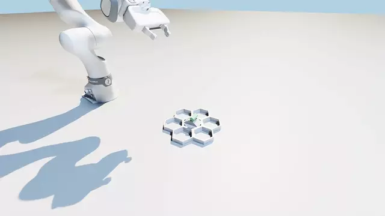

# Franka FR3 switch circuit breaker (simple)



Policy switches the toggle and withdraws with closed fingers (2x speed, nominal physics).

## Task

The task lives in `tasks_simple.py` of `isaaclab-hiveboard` and the RL layer in `env.py`, `configs/train.yaml` and `configs/robots/franka.yaml`.

| | |
|---|---|
| Robot | Franka Research 3 with Franka Hand |
| Goal | push the toggle from +30 to -30 degrees, then withdraw |
| Interaction | either finger pad can push, no pinch needed |
| Episode | 9 s at 20 Hz |
| Randomization | mechanism position and dynamics, arm starts, delays and observation noise |
| Starts | states from the cuRobo expert bank, half of them mid-trajectory |
| Gym ID | `Isaac-HiveBoard-Franka-SwitchCircuitBreakerSimple-RL-v0` |

## Method

The policy follows a cuRobo expert that approaches below the toggle, pushes it along its switching axis and retreats. The rewards are split into a task signal that only pays after the pads touch the toggle, a style signal that copies the expert bank, and hardware terms for smooth and gentle contact.

| Group | Term | Weight | What it does |
|---|---|---|---|
| Task | `task_progress` | 10 | toggle progress after pad contact, plus a bonus at the goal |
| Style | `track_expert_mechanism` | 6 | toggle angle follows the expert, only while the pads touch it |
| Style | `track_expert_mechanism_coarse` | 5 | same with a wider tolerance |
| Style | `track_expert` | 3 | arm joints follow the expert |
| Style | `track_expert_gripper` | 3 | fingers follow the expert |
| Style | `track_expert_contact` | 3 | pad contact matches the expert |
| Style | `track_expert_coarse` | 2 | arm joints follow the expert, wider tolerance |
| Style | `track_expert_velocity` | 2 | arm joint velocity follows the expert |
| Hardware | `pad_lateral` | -2 | pad force off the push axis above 35 N |
| Hardware | `torque_saturation` | -2 | joint torque near the limit |
| Hardware | `action_rate` | -1 | jerky actions |
| Hardware | `gripper_chatter` | -1 | gripper toggling quickly |
| Hardware | `joint_limits` | -1 | joints near their limits |
| Hardware | `arm_joint_acc` | -0.03 | high joint acceleration |
| Hardware | `action_magnitude` | -0.02 | large actions |
| Hardware | `pad_force` | -0.005 | pad force above 80 N |
| Hardware | `arm_joint_vel` | -0.001 | fast arm joints |

The expert never needs more than about 84 N to flip the toggle. Higher forces only come from pressing into the end stop after the flip, so `pad_force` starts at 80 N and leaves the flip itself free.

The valve's `pinch_lever` and `reach_lever` are off. Episodes end when the arm hits something or drifts too far from the expert.

## Results

Trained for 300 iterations with 4096 environments and evaluated on 300 episodes from a held-out expert bank. The expert succeeds 96.6% of the time on the training bank and 97.5% on the held-out bank.

| Metric | Result |
|---|---|
| Complete rate | **100%** |
| Time to switch | 3.24 s |
| Peak pad force, median / p99 | 96 / 326 N |
| Peak off-axis force, median / p99 | 48 / 192 N |
| Maximum pad force | 541 N |
| Arm collisions | 0 / 300 |

An episode is complete when the toggle reaches the goal after pad contact, stays there, and the gripper ends at least 6 cm away with no contact. Forces use each episode's peak.

## What needs to be improved

- **Force peaks** remain in rare episodes that hit the end stop hard (541 N maximum).
- **Value loss is high** and grows during training, as in the ball valve. Drift terminations end about half of the training episodes and cut long returns short, so return normalization or a softer drift limit should help.

## Reproduce

```bash
export RL_ROBOT=franka RL_TASK=switch_circuit_breaker_simple
just bank --num_trajectories 1000 --plan_batch_size 64
just bank --num_trajectories 200 --plan_batch_size 64 --seed 10020 --output <heldout_bank.pt>
just train --num_envs 4096 --seed 0 --max_iterations 300 \
    env.sim.physics.use_cuda_graph=true env.sim.physics.solver_cfg.iterations=50 \
    env.sim.physics.solver_cfg.ls_iterations=10 env.sim.physics.solver_cfg.ccd_iterations=30
just eval logs/rsl_rl/franka_switch_circuit_breaker_simple/<run>/model_299.pt --episodes 300 \
    --num_envs 100 --seed 100 env.events.reset_from_bank.params.path=<heldout_bank.pt> \
    env.sim.physics.use_cuda_graph=true env.sim.physics.solver_cfg.iterations=50 \
    env.sim.physics.solver_cfg.ls_iterations=10 env.sim.physics.solver_cfg.ccd_iterations=30
just video logs/rsl_rl/franka_switch_circuit_breaker_simple/<run>/model_299.pt <video_dir> \
    --seed 100 env.sim.physics.use_cuda_graph=true env.sim.physics.solver_cfg.iterations=50 \
    env.sim.physics.solver_cfg.ls_iterations=10 env.sim.physics.solver_cfg.ccd_iterations=30
```
