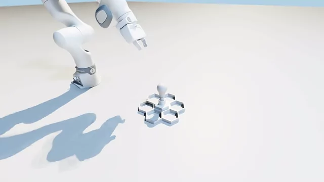

# Franka FR3 tighten lamp (simple)



`model_999.pt` performs screw-and-regrasp cycles (8x speed, publication preset).
This rollout reaches 89.6% progress without completing the task.

## Task

The task lives in core `tasks_simple.py`. Learning shares `env.py`,
`configs/train.yaml` and `configs/robots/franka.yaml` with the
[ball-valve](../open_ball_valve_simple/README.md),
[circuit-breaker](../switch_circuit_breaker_simple/README.md) and
[small-valve](../open_small_valve_simple/README.md) policies.

| | |
|---|---|
| Robot | Franka Research 3 with Franka Hand |
| Goal | tighten through -7.5 pi rad (3.75 turns), then release and withdraw |
| Goal tolerance | 0.1 rad, approximately 5.7 degrees |
| Screw motion | 6.4 mm per turn, with 24 mm total axial travel |
| Interaction | pinch during each turn; release and regrasp between strokes |
| Episode | 140 seconds at a 20 Hz policy rate |
| Starts | states from a task-specific cuRobo expert bank |
| Randomization | mechanism position, arm starts, target delay and observation noise |
| Gym ID | `Isaac-HiveBoard-Franka-TightenLampSimple-RL-v0` |

## Method

A separate PPO policy is trained from scratch with `[512, 256, 128]` actor and critic MLPs.
The actor uses proprioception, an initial mechanism estimate and five-frame history;
the critic also sees true state, contacts, dynamics and expert errors.

The core `screw_regrasp` expert approaches, grips, turns up to 90 degrees, releases and clears
before regrasping. Its sampled turning rate is 0.5-0.75 rad/s. Training uses 1,000 trajectories
(60.4% raw expert success, seed 0); the held-out bank has 200 (60.4%, seed 10020).
Bank dynamics fix friction, damping and armature at 0, 1 and 0.01 respectively.
Collection uses 512 environments, planning batches of 64 and physics settings 50/10/30
with CUDA graphs. Only goal-credited, released/clear trajectories without fallbacks are retained.

The simulated lamp/socket contact and screw physics do not closely reproduce the real assembly.
This limits the realism of the expert demonstrations and the policy trained from them.

Half of training resets start mid-trajectory. Angle references follow the bank through regrasp
pauses. The axial target follows measured rotation:
`s = clamp(0.024 + 0.0064 * theta / (2*pi), 0, 0.024)` metres.
Task overrides live under `tasks.tighten_lamp_simple` in the Franka YAML.

Collection uses shared cuRobo local-IK configuration and CUDA/Warp synchronization fixes.
Completed waves are saved to a `.partial` bank; final banks record the physics configuration.
Keep the core revision, environment count and planning batch fixed when comparing collections.

## Rewards

| Group | Term | Weight | What it does |
|---|---|---|---|
| Task | `task_progress` | 20 | new tightening progress while pinched, plus completion |
| Task | `pinch_lever` | 10 | bilateral pinch while the expert grips |
| Task | `reach_lever` | 3 | position-only reach, with a 3 cm scale |
| Task | `release_clear` | 3 | credited goal, open fingers and clear withdrawal |
| Style | `track_gripper_command` | 10 | match the expert's binary open/close command |
| Style | `track_expert_gripper` | 3 | measured finger position, 4 mm reward width |
| Style | `track_expert_mechanism` | 6 | expert angle, 0.1 rad width, contact-gated |
| Style | `track_expert_mechanism_coarse` | 5 | same with a 0.5 rad width |
| Style | `track_expert` | 3 | expert arm joint positions, 0.15 rad width |
| Style | `track_expert_coarse` | 2 | same with a 0.5 rad width |
| Style | `track_expert_velocity` | 2 | expert arm velocities, 0.15 rad/s width |
| Style | `track_expert_contact` | 3 | each pad's contact state matches the expert |
| Hardware | `turn_without_pinch` | -10 | ungripped mechanism speed above 0.05 rad/s |
| Hardware | `pad_force` | -0.002 | squared total pad-force excess above 100 N |
| Hardware | `pad_lateral` | -2 | gripper-relative lateral pad force above 35 N |
| Hardware | `palm_force` | -0.1 | linear palm normal-force excess above 25 N |
| Hardware | `mechanism_pull` | -0.005 | squared net outward-force excess above 15 N |
| Hardware | `mechanism_push` | -0.0025 | squared net inward-force excess above 25 N |
| Hardware | `mechanism_lateral` | -0.0025 | squared net sideways-force excess above 25 N |
| Hardware | `overspeed` | -1 | mechanism speed above 1.5x the commanded rate |
| Hardware | `torque_saturation` | -2 | joint torque above 80% of its limit |
| Hardware | `action_rate` | -1 | changes in commanded actions |
| Hardware | `joint_limits` | -1 | arm joints within 0.1 rad of a limit |
| Hardware | `gripper_chatter` | -1 | gripper switches less than 0.5 s apart |
| Hardware | `arm_joint_acc` | -0.03 | acceleration, quadratic up to 10 rad/s2 |
| Hardware | `action_magnitude` | -0.02 | large actions |
| Hardware | `arm_joint_vel` | -0.001 | fast arm joints |

A pinch requires a close command, at least 5 N of squeeze on each pad and finger positions
above 10.6 mm. Progress credits each gain once; completion adds a one-time 0.5 bonus before
weighting. Mechanism tracking requires both-pad contact and a close command whenever the
expert grips. Position-only reach allows rotation and regrasping without a fixed yaw target.

`pad_lateral` is quadratic from 35 to 150 N, then linear. Pad-force costs sum over both pads.
Net load estimates sum reactions from both pads and the palm in the mechanism source frame:
+X pulls outward/up at the nominal Franka pose, -X pushes inward/down, and YZ is sideways.
Opposing squeeze forces cancel in these net loads. All force thresholds are soft penalties.

Arm links 1-7 retain collision termination above 10 N. Palm contact contributes force costs
instead. The release reward requires credited completion, open fingers, pad forces below
1 N and TCP clearance of at least 6 cm from the grasp frame.

## Evaluation and results

Run `2026-11-15_00-52-41_lamp_full`: seed 0, 4,096 environments, 1,000 PPO iterations,
trained from scratch. [W&B run](https://wandb.ai/joao-h02-usp-universidade-de-s-o-paulo/isaaclab-hiveboard/runs/737plwnt).

Evaluation of `model_999.pt` used 300 episodes, 100 environments and seed 100,
visiting 159 distinct held-out bank entries. Solver settings match training (50/10/30).
Starts use bank dynamics, registration noise and target delay; drift/lag terminations are off.

**Success** requires the goal while both pads contact and the gripper is commanded closed.
Strict bilateral pinch at the goal is reported separately. **Complete** also requires the
goal retained and the gripper released and clear at the end.

| Metric | Result |
|---|---|
| Goal reached while held | **254/300 (84.7%)** |
| Complete, including final release/clearance | **33/300 (11.0%)** |
| Episodes with a bilateral pinch | 300/300 (100%) |
| Goal reached while bilaterally pinching | 251/300 (83.7%) |
| Time to goal, mean +/- std | 110.05 +/- 7.57 s |
| Peak pad force, median / p99 | 158 / 554 N |
| Maximum pad force | 707 N |
| Peak bilateral squeeze, median / p99 | 70 / 71 N |
| Peak gripper-relative lateral force, median / p99 | 153 / 519 N |
| Peak net pull, median / p99 | 68 / 242 N |
| Peak net push, median / p99 | 128 / 329 N |
| Peak net sideways load, median / p99 | 119 / 422 N |
| Arm-collision / invalid episodes | 3 / 0 |

Force quantiles use each episode's peak. Mean pinch duration is 58.72 s;
three episodes contain a gripper switch within 0.5 s of the previous switch.
Report: `eval_model_999.json` alongside the checkpoint. Results cover one training seed.

## What needs to be improved

- **Lamp/socket physics:** improve contact and screw dynamics to better match the real mechanism.
- **Expert and policy motion:** both sometimes produce inefficient joint movements. Improve
  expert grasp/regrasp paths and bank quality, and the policy's smoothness, coordination and tracking.
- **Completion:** 84.7% reach the goal while held, but only 11.0% finish released and clear.
- **Forces and collisions:** the soft costs still permit large impacts and three arm collisions.
- **Validation:** repeat training seeds and collect fresh starts after checkpoint selection.
- **Shared planner:** the core IK changes alter other expert paths; matched tests found a
  repeatable ball-valve failure despite improved aggregate expert retention.

## Reproduce

Run from the repository root after `just setup` and `just assets`.
Use the explicit recipes below: the default `just all` expert-success gate of 0.8 skips this bank.

```bash
export RL_ROBOT=franka RL_TASK=tighten_lamp_simple
root=logs/rsl_rl/franka_tighten_lamp_simple
heldout=logs/expert_bank/franka_tighten_lamp_simple_heldout.pt

just bank --num_envs 512 --num_trajectories 1000 --plan_batch_size 64 --seed 0
just bank --num_envs 512 --num_trajectories 200 --plan_batch_size 64 --seed 10020 \
    --output "$heldout"

just train --num_envs 4096 --seed 0 --max_iterations 1000 --run_name lamp_full \
    env.sim.physics.use_cuda_graph=true env.sim.physics.solver_cfg.iterations=50 \
    env.sim.physics.solver_cfg.ls_iterations=10 env.sim.physics.solver_cfg.ccd_iterations=30
```

Use the completed checkpoint below, or replace `run` with your training directory.

```bash
run="$root/2026-11-15_00-52-41_lamp_full"
checkpoint="$run/model_999.pt"

just eval "$checkpoint" --episodes 300 --num_envs 100 --seed 100 \
    env.events.reset_from_bank.params.path="$heldout" \
    env.sim.physics.use_cuda_graph=true env.sim.physics.solver_cfg.iterations=50 \
    env.sim.physics.solver_cfg.ls_iterations=10 env.sim.physics.solver_cfg.ccd_iterations=30
```

## Visualize and record

Default camera: eye `[0.90, -0.55, 0.55]`, lookat `[0.60, 0.00, 0.12]`, relative to environment 0.
Keep viewer results separate from the 300-episode report.

```bash
mkdir -p tests
just eval "$checkpoint" --episodes 100 --num_envs 1 --visualizer newton_gl --seed 100 \
    --output tests/lamp_viewer.json \
    env.events.reset_from_bank.params.path="$heldout" \
    env.sim.physics.use_cuda_graph=true env.sim.physics.solver_cfg.iterations=50 \
    env.sim.physics.solver_cfg.ls_iterations=10 env.sim.physics.solver_cfg.ccd_iterations=30
```

Publication recording uses 1080p RTX rendering, 50 fps and CRF 12 encoding, streamed to FFmpeg
for the long episode. It uses one standard training-bank start, no registration noise or delays,
and a fixed 0.30 rad/s command. Publication friction/damping/armature are 0.05/0/0.005.
This preset differs from held-out evaluation; the embedded rollout reaches 89.6% progress
without completing the task.

```bash
video=videos/franka_tighten_lamp_simple
just video "$checkpoint" "$video" --seed 100 \
    env.sim.physics.use_cuda_graph=true env.sim.physics.solver_cfg.iterations=50 \
    env.sim.physics.solver_cfg.ls_iterations=10 env.sim.physics.solver_cfg.ccd_iterations=30
```
